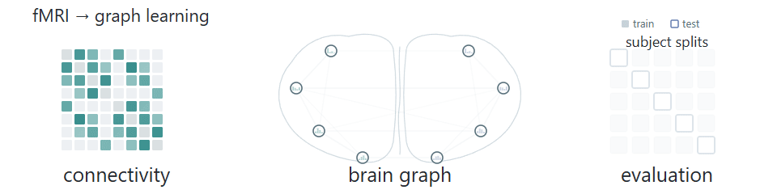

# Mostafa Abdelmegeed

**Senior Data Scientist & AI Engineer · Machine Learning / GenAI**

*Mostly models. Occasionally qubits.*

I work on production ML and generative AI, with a particular interest in how we evaluate agentic systems. My research is in brain connectivity. Lately, I've been exploring quantum ML for neuroimaging.

**[Fulbright Scholar](https://www.uncg.edu/news/student-from-egypt-wants-to-use-data-science-to-transform-medicine/)** · **M.S. Computer Science, UNCG** · **[Two IEEE ISBI 2025 papers](#publications)**

### Career in brief

I've spent six years building ML systems, including clinical imaging tools. My software engineering work has also covered automotive perception. Alongside that, I've led ML teams and taught data science and computer vision.

Much of my recent work is on RAG and agentic systems. I build evaluation pipelines with LLM judges and synthetic adversarial tests, and work on the cloud infrastructure needed to deploy them.

### Certifications & learning

  
  &nbsp;
  
  &nbsp;
  
  &nbsp;
  
  &nbsp;
  

[AWS Certified Machine Learning – Specialty](https://www.credly.com/badges/cb6d45f1-cfde-4147-9f2a-18c95d0acdb5) · earned March 2026 · valid through March 2029

Credential details & academic honors

- [AWS Certified Machine Learning – Specialty](https://www.credly.com/badges/cb6d45f1-cfde-4147-9f2a-18c95d0acdb5) · earned 31 March 2026 · expires 31 March 2029
- [AWS Certified Machine Learning Engineer – Associate](https://www.credly.com/badges/2b569d6b-989f-4991-9b40-368ac247b56c) · expires 25 August 2028
- [Google Cloud Generative AI Leader](https://www.credly.com/badges/050200d5-2cd6-4d73-8c98-5eead6f1810e) · expires 16 May 2029
- [IBM Quantum Business Foundations](https://www.credly.com/badges/226ca57e-cb9c-4acc-99d1-05fb51526d12) · foundational learning badge · 2025
- [IBM Generative & Agentic AI Foundation](https://www.credly.com/badges/1960bd09-b2ed-45c9-b735-6e879a9f49f5) · foundation badge · expires 15 December 2026
- **M.S. Computer Science, Data Science concentration** · UNC Greensboro · 4.0 / 4.0 GPA
- **B.Sc. Systems & Biomedical Engineering** · Cairo University
- **Outstanding Graduate Student Award** · UNC Greensboro
- **Phi Kappa Phi Scholar**
- [IBM Big Data Engineer - Mastery Award for Students 2018](https://www.credly.com/badges/7a6adb83-b42c-4892-8f17-1a58bc4f47ca) · issued 2019

### Publications

<picture>
  <source media="(prefers-reduced-motion: reduce)" srcset="assets/graph-learning-dark.png">
  <source media="(prefers-color-scheme: dark)" srcset="assets/graph-learning-dark.gif">
  <source media="(prefers-color-scheme: light)" srcset="assets/graph-learning-light.gif">
  
</picture>

- [Functional-Positional Context Embedding in Graph Neural Networks for Improved Parkinson's Disease Diagnosis](https://doi.org/10.1109/ISBI60581.2025.10980965). *IEEE ISBI 2025, first author.*
- [Edge-Boosted Graph Learning for Functional Brain Connectivity Analysis](https://arxiv.org/abs/2504.14796). *IEEE ISBI 2025, co-author.*

### Selected work

| Project | Focus |
| :--- | :--- |
| **[Agent trace evaluation](https://github.com/MostafaAbdelmegeed/agent-trace-eval)** | Checks for agent tool use, citation provenance, approval order, and regressions, with a synthetic replay demo. |
| **[Brain connectivity](https://github.com/MostafaAbdelmegeed/brain_connectome)** | Graph neural networks for fMRI connectivity, with brain-specific embeddings and cross-validation. |
| **[Medical image review](https://github.com/MostafaAbdelmegeed/medical_dataset_reviewer)** | A desktop tool for reviewing DICOM/NIfTI images alongside segmentation volumes. |
| **[GNN Rising Stars](https://github.com/MostafaAbdelmegeed/gnn-mini-comp)** | A graph-learning challenge with graph and tabular baselines, automated scoring, and a leaderboard. |
| **[Quantum Neuro ML](https://github.com/MostafaAbdelmegeed/quantum-neuro-ml)** | Hybrid quantum–classical learning for neuroimaging, with matched classical baselines as a guiding principle. *In progress.* |

Python · PyTorch · Hugging Face · scikit-learn · SQL · Docker · AWS / Azure / GCP

[LinkedIn](https://www.linkedin.com/in/mostafaabdelmegeed) · [Credly](https://www.credly.com/users/mostafa_abdelmegeed) · [Email](mailto:mostafa0as3d@gmail.com)
